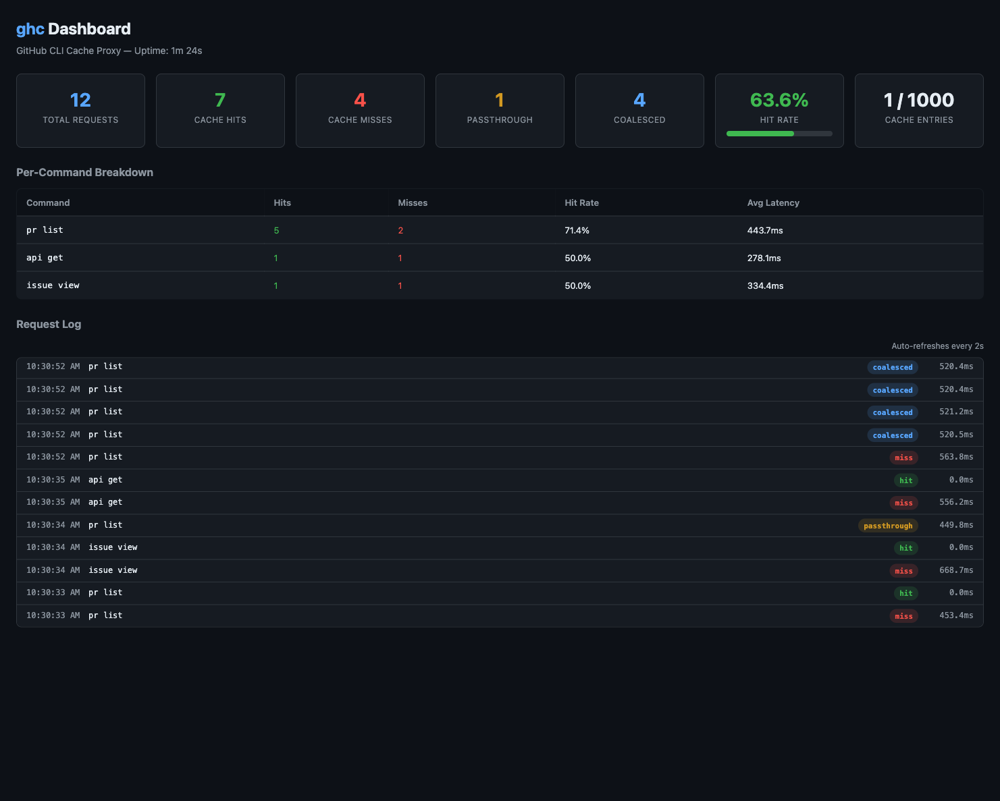

# ghx — GitHub CLI Cache Proxy

[](https://github.com/brunoborges/ghx/actions/workflows/ci.yml)
[](https://github.com/brunoborges/ghx/releases/latest)
[](https://goreportcard.com/report/github.com/brunoborges/ghx)
[](LICENSE)

<p align="center">
  
</p>

A caching proxy for the [GitHub CLI (`gh`)](https://cli.github.com/) that eliminates redundant API calls, prevents rate limiting, and dramatically speeds up repeated commands.

**Built for AI agent workflows** where multiple agents (Copilot CLI, coding agents, MCP servers) hammer the same `gh` commands simultaneously.

## Highlights

- 🚀 **10x faster** cached responses (~0.1s vs ~1s)
- 🔄 **Singleflight coalescing** — 5 agents asking the same thing = 1 API call
- 🎯 **Allowlist-based** — only caches known-safe read-only commands
- 🧹 **Auto-invalidation** — mutations flush related cache entries
- 📊 **Web dashboard** — real-time hit rates, per-command stats, request log
- 🔌 **Drop-in replacement** — just use `ghx` instead of `gh`
- 📦 **No `gh` required** — auto-downloads GitHub CLI on first use if not installed

## Quick Start

### Install

```bash
# macOS (Homebrew)
brew tap brunoborges/tap && brew install ghx

# macOS / Linux (script)
curl -fsSL https://raw.githubusercontent.com/brunoborges/ghx/main/install.sh | bash

# Windows (PowerShell)
irm https://raw.githubusercontent.com/brunoborges/ghx/main/install.ps1 | iex
```

See the [full documentation](specs/DOCS.md#install) for manual download, building from source, and agent plugin setup.

### Usage

Use `ghx` like `gh` — the daemon starts automatically on first use. For the
read examples below to use shared caching, authenticate on the selected host,
let ghx resolve its credential fingerprint, and bind the repository explicitly
with `GH_REPO`:

```bash
export GH_REPO=owner/repo
ghx pr list --repo owner/repo --json number,title   # cache eligible
ghx issue view 42 --json title,state                 # cache eligible
ghx pr create --title "My PR" --body "Description"   # mutation — passes through
```

A cache-eligible read can populate an entry; a later matching read may hit it
while the entry remains valid.

Unbound repository/host or credential identity passes through without shared
caching, and mutations flush all in-memory entries. See the cache-key and
invalidation details in the full documentation.

## Documentation

📖 **[Full documentation](specs/DOCS.md)** — install options, configuration, daemon & cache management, what gets cached, architecture, and more.

🚀 **[Release process](RELEASE.md)** — how maintainers cut app and plugin releases.

## License

[MIT](LICENSE)
